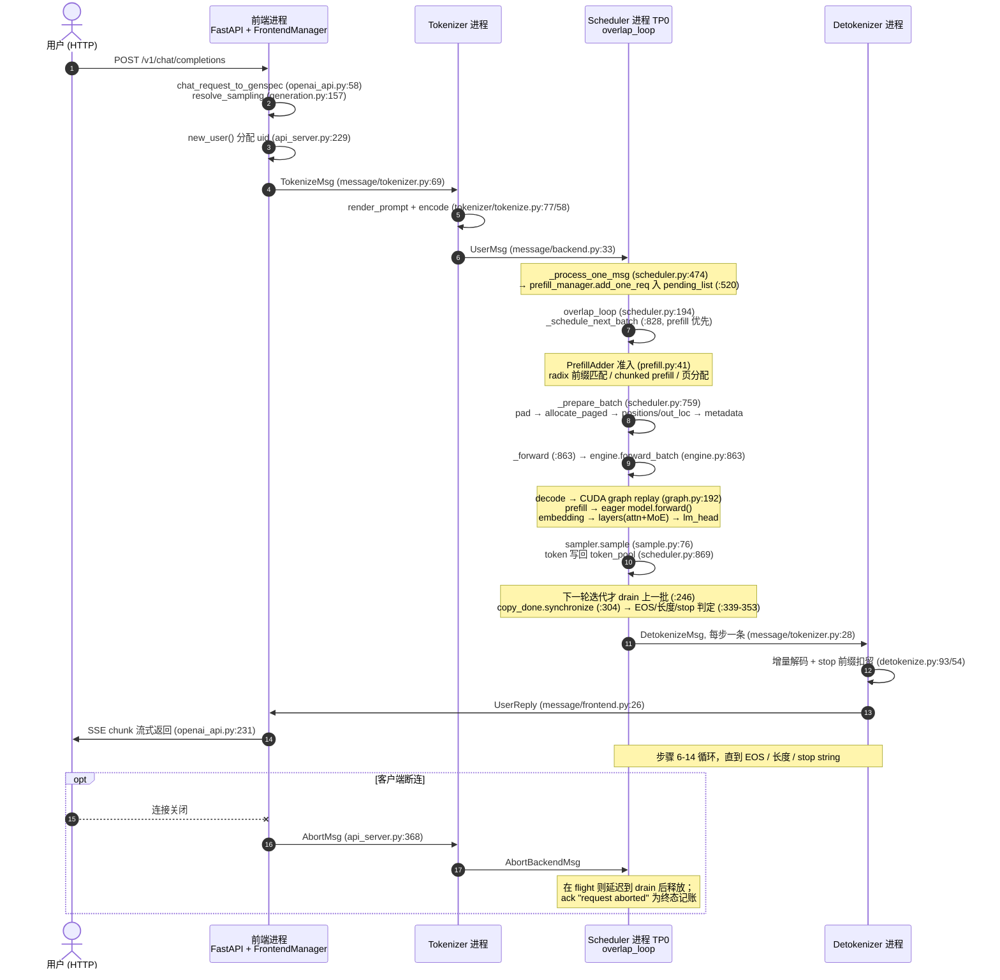

# 推理计算流程梳理（Inference Pipeline）

承接《模型加载流程梳理》（`docs/model-loading.zh.md`）：server ready 之后，一条用户请求从
HTTP 进入到 token 流式返回的完整计算链路。所有引用均为 `python/freetoken/` 下的 `文件:行号`，
行号均已对照源码核验。

## 0. 总览

```
HTTP POST /v1/chat/completions
   │
   ▼
前端进程 (FastAPI)          GenSpec 归一化 → 分配 uid → TokenizeMsg
   │  ZMQ PUSH  ipc:///tmp/freetoken_4
   ▼
Tokenizer 进程              chat template 渲染 + encode → UserMsg
   │  ZMQ PUSH  ipc:///tmp/freetoken_0
   ▼
Scheduler 进程 (TP0)        overlap_loop 无限循环：
   │                          ① 收消息入队（UserMsg → pending_list）
   │                          ② _schedule_next_batch 组批（prefill 优先，decode 跟上）
   │                          ③ _prepare_batch 页分配/元数据
   │                          ④ _forward → engine.forward_batch（模型 forward + 采样）
   │                          ⑤ 下一轮 drain 上一批：EOS/stop 判定 → DetokenizeMsg
   │  ZMQ PUSH  ipc:///tmp/freetoken_1（每个生成 token 一条）
   ▼
Detokenizer 进程            增量解码 + stop 裁剪 → UserReply
   │  ZMQ PUSH  ipc:///tmp/freetoken_3
   ▼
前端进程                    按协议格式化为 SSE chunk 流式写回
```

### 跨进程时序图



### overlap 时间线

调度 CPU 工作（组批、页分配、H2D）与 GPU 计算分属两条 CUDA stream，错开一个 batch：

```
scheduler stream:  [收消息·组批 N+1·准备元数据]      [drain N·组批 N+2]        ...
                        │ H2D 拷贝与 kernel 发射
engine stream:         [   batch N: forward + sample ────────►]  [batch N+1 ...]
                                  └ copy_done_event.record ──► drain N 前 synchronize
```

## 1. 进程与消息通道

五个 ZMQ IPC 通道（`ipc:///tmp/freetoken_N` + pid 后缀，见 `scheduler/config.py:26-35`、
`server/args.py:49/55`；msgpack 序列化，`message/utils.py`）：

| 方向 | 消息类型 | 通道 |
|---|---|---|
| 前端 → tokenizer | `TokenizeMsg`、`AbortMsg`、`CacheRebuildMsg`（message/tokenizer.py:69/78/83） | `_4`（无 tokenizer 进程时复用 `_0`） |
| tokenizer → scheduler | `UserMsg`、`AbortBackendMsg`、`CacheRebuildBackendMsg`（message/backend.py:33/43/48），多条打包 `BatchBackendMsg`(:23) | `_0` |
| scheduler → detokenizer | `DetokenizeMsg`、`PromptAdmittedMsg`、`ErrorReplyMsg`（message/tokenizer.py:28/54/106），多条打包 `BatchTokenizerMsg`(:23) | `_1` |
| scheduler rank0 → 其它 TP rank | backend 消息广播（PUB/SUB） | `_2` |
| tokenizer/detokenizer → 前端 | `UserReply`、`CacheRebuildReply`（message/frontend.py:26/62） | `_3` |

tokenizer 与 detokenizer 是**同一个 worker 函数**（`tokenizer/server.py:128 tokenize_worker`）
的两个实例，靠监听不同通道区分：tokenizer 实例 PULL `_4`（前端的 TokenizeMsg），detokenizer
实例 PULL `_1`（scheduler 的下行）。

## 2. 请求进入：前端 → tokenizer → scheduler

1. **协议归一化**：`/v1/chat/completions`（server/openai_api.py:116）→
   `handle_chat_completion`（:147）→ `chat_request_to_genspec`（:58），把 OpenAI/Anthropic/
   Responses 三种协议统一成 `GenSpec`（generation.py:132）；采样参数经 `resolve_sampling`
   （:157）补上 checkpoint `generation_config` 的默认值。
2. **分配 uid**：`submit_generation`（generation.py:261）→ `FrontendManager.new_user`
   （api_server.py:229，uid 自增，登记 ack/event map）。
3. **发给 tokenizer**：`send_one(TokenizeMsg)`（api_server.py:319）ZMQ PUSH 到 `_4`。
4. **tokenizer 进程**：`tokenize_worker` 主循环（tokenizer/server.py:128，PULL `_4`）把队列
   取空聚合，`TokenizeManager.tokenize`（tokenize.py:58）用 HF `apply_chat_template`
   渲染（`render_prompt` :77）后 encode 成 int32 CPU tensor；失败转终态 `UserReply.error`。
   成功请求打包成 `UserMsg` 推给 scheduler（server.py:256-260，`_0` 通道）。
5. 前端此时挂起在 `wait_for_ack`（api_server.py:323）上，逐条消费 `listen`（:241）PULL 到的
   `UserReply`，直到该 uid 的 `finished`；SSE 流由各协议 formatter 产出。断连时
   `stream_with_cancellation`（:356）触发 `abort_user`（:368）。

## 3. 调度主循环（scheduler/）

`Scheduler` 继承 `SchedulerIOMixin`（io.py:15）。`run_forever`（scheduler.py:278）默认跑
`overlap_loop`（:194；设 `DISABLE_OVERLAP_SCHEDULING` 退化为 `normal_loop` :250）。
一次 overlap 迭代（scheduler.py:194-248）：

1. 收消息：`receive_msg`（blocking 与否取决于是否有在途批次/待跑批，:205-210）。TP=1 走
   `_recv_msg_single_rank`（io.py:79）；TP>1 时 rank0 PULL 后经 PUB 广播原始字节
   （`_recv_msg_multi_rank0/1`，io.py:88/109），其余 rank SUB 消费——各 rank 无需逐条转发。
   逐条 `_process_one_msg`（scheduler.py:474）：
   - `UserMsg`（:480）：超长直接回 `ErrorReplyMsg(context_length_exceeded)`（:510）；
     否则 `prefill_manager.add_one_req`（:520）进 `pending_list`。
   - `AbortBackendMsg`（:521）：先写 `_abort_tombstones`（防 abort 先于 UserMsg 到达时请求
     "复活"），再从 prefill/decode 管理器摘除；若该请求在 in-flight 批次里只标
     `req.aborted=True`，延迟到 drain 时释放。
   - `CacheRebuildBackendMsg`：挂到 `_pending_rebuild`，等空闲安全点执行。
2. 空闲安全点执行挂起的 cache rebuild（:217-220）。
3. `self.stream.wait_stream(self.engine.stream)`（:228）后 `_schedule_next_batch`（:229）：
   **组批、页分配、H2D 拷贝全部在 scheduler stream 上，与上一批的 GPU 计算重叠**。
4. 切到 engine stream（:232），`_restore_linear_states`（:237，GDN 前缀命中的 COW 恢复），
   `_forward`（:238）发射本批 kernel——**不等待完成**。
5. `self.stream.wait_stream(self.engine.stream)`（:245）后 `_process_last_data(last_data)`
   （:246）处理**上一批**结果，再 `_flush_abort_acks`（:247）。返回在途批次给下一轮。

### 组批策略

- **prefill 优先**：`_schedule_next_batch`（scheduler.py:828-833）先问 PrefillManager，
  没有可跑的再问 DecodeManager。
- **PrefillManager**（prefill.py:233）：`PrefillAdder`（:41）做准入，每请求 `_try_allocate_one`
  （:51）依次过四道门——radix 前缀匹配 `match_req`、KV 余量（含 decode 在途保留
  `reserved_size`）、hybrid 模型预留 3 个 GDN slot（:71-76）、SWA 窗口 seat（:82-90）——
  通过后 `table_manager.allocate()` 分配 table 行，命中的前缀 KV 地址直接写进 page_table
  （:93-103），prompt 已知部分 H2D 进 token_pool。然后 `_add_one_req`（:113）按
  `prefill_budget`（= `min(max_extend_tokens 默认 8192, cache_manager.prefill_chunk_budget)`，
  scheduler.py:128-131）切块：装不下的部分生成 `ChunkedReq`（:28，不采样、不进 decode），
  下一轮继续。
- **DecodeManager**（decode.py:10）：`running_reqs` 集合。prefill 批 forward 完由
  `filter_reqs`（:14）把 `can_decode` 的请求转入；`schedule_next_batch`（:32）把全部
  running 请求按 uid 排序组成一个 decode batch。
- **状态流转**：UserMsg → `pending_list`（waiting）→ PrefillAdder 产出 Req（长 prompt 拆
  ChunkedReq 逐块续）→ prefill forward + `filter_reqs` → `running_reqs`（running）→
  每个 decode step 采样一个 token → EOS/长度/stop 时在 `_process_last_data` 里
  `remove_req` + 释放资源 → finished。

### KV 与页管理

- **TableManager**（table.py:4）：每请求占一行 `page_table[table_idx]`（int32，存 token
  槽位地址），配套的 `token_pool`（GPU 上的 token id 池，prompt 与采样 token 都存这里）；
  `max_running_req` 个 slot 的 free-list——并发上限由它控制。
- **CacheManager**（cache.py:32）：页级 KV 管理。`prefix_cache` 按 `cache_type` 装
  radix / SWA radix / hybrid radix（GDN 快照），提供前缀匹配（`match_req`）与 LRU 驱逐；
  `allocate_paged`（:256）为 `[cached_len, device_len)` 区间分配页并把页地址 scatter 进
  page_table，空间不足先驱逐 radix 树里的可驱逐页。请求结束走 `cache_req`：未完成则把
  前缀 insert 进 radix 树供后续请求复用（prefix cache 命中是新请求免算 prompt 的关键），
  完成则连尾部一起释放。

## 4. 一次 forward

### 4.1 _prepare_batch（scheduler.py:759）

1. `graph_runner.pad_batch`（:760 → engine/graph.py:200）：decode 且 bs ≤ max_graph_bs 时
   用 dummy_req 补齐到最近的捕获 bs（padding 请求全部指向保留的 dummy 页）。
2. `cache_manager.allocate_paged`（:777）为本次 extend 的 token 分配 KV 页。
3. 构造三组索引（`_make_positions/_make_input_tuple/_make_write_tuple`，scheduler.py:874-905，
   pinned 内存 + 非 blocking H2D）：
   - `positions`：每 token 的位置 id；
   - `input_tuple = (table_idx 列, positions)`：从 `token_pool` gather 本步输入的索引；
   - `write_tuple`：把采样出的新 token 写回 `token_pool[table_idx, device_len]` 的位置。
4. `batch.out_loc = page_table[input_tuple]`（:783）——**本步 K/V 要写入的槽位**，由
   scheduler 算好，attention 层无需再查表。
5. `attn_backend.prepare_metadata`（:810）按 backend 拼元数据（如 triton 用 page_table 拼
   访问索引）；`sampler.prepare`（:813）把每请求的 temperature/top_k/top_p 打成设备张量。

### 4.2 _forward（scheduler.py:863）→ Engine.forward_batch（engine/engine.py:863）

```python
batch.input_ids = self.token_pool[input_mapping]   # GPU 内 gather，上批采样结果直接喂下批
forward_output = self.engine.forward_batch(batch, sample_args)
self.token_pool[output_mapping] = forward_output.next_tokens_gpu
self.decode_manager.filter_reqs(batch.reqs)
```

`forward_batch`（engine.py:863-883）：

1. 模型通过 `ctx.forward_batch(batch)` 设置的全局上下文拿数据（**无参 forward**，见 §5）。
2. 分叉（:866-869）：decode 且 bs 可覆盖 → `graph_runner.replay`（engine/graph.py:192）；
   否则 eager `self.model.forward()`。**prefill 永远 eager**（`can_use_cuda_graph`
   graph.py:189-190 只看 `batch.is_decode`）。
3. 每个 req `complete_one()`（:875-876）推进计数。
4. `logits[:batch.size]` → `sampler.sample`（:879）→ `next_tokens_gpu.to("cpu",
   non_blocking=True)` 并 `copy_done_event.record`（:880-882）。
5. 回到 scheduler：`token_pool[output_mapping] = next_tokens_gpu`（scheduler.py:869）——
   采样 token 立刻写回 token_pool，下批 gather 就能读到，这是 overlap 流水线的闭环。

**CUDA graph replay**（engine/graph.py:192-198）：`buffer.copy_from(batch)` 把本批
input_ids/out_loc/positions/GDN 槽位拷进静态 `GraphCaptureBuffer`（:22，捕获时就用它的
地址，`set_batch` :43 把 batch 的 tensor 换成静态 buffer 视图）→
`attn_backend.prepare_for_replay`（如 FlashInfer 重新 plan）→ `g.replay()` → 返回
`buffer.logits[:size]`。捕获时对 bs 列表（1,2,4,8,16…，`_determine_cuda_graph_bs` :68
按空闲显存定上限）各捕一张，共享 memory pool（:181-182）。

### 4.3 采样（engine/sample.py）

- `prepare`（:58）：全部请求都 greedy 时返回 `temperatures=None`，sample 直接
  `argmax`（:78-79）——大批量 decode 的常见快路径。
- 否则 `sample_impl`（:24）：装了 flashinfer 用 flashinfer 的 kernel，否则用自研 Triton
  kernel——softmax(logits/T) 后按需派发 top_k / top_p / top_k+top_p 组合采样。
- **没有 penalty**：`SamplingParams`（core.py:19）只有 temperature/top_k/top_p/ignore_eos/
  max_tokens/stop_strs，无 repetition/frequency/presence penalty。

### 4.4 copy_done_event：overlap 正确性的闸门

D2H 拷贝是非阻塞的，scheduler 在下一轮 `overlap_loop` 处理这批结果前必须
`copy_done.synchronize()`（scheduler.py:304）才能安全读 `next_tokens_cpu`。engine stream
上的 forward 与 scheduler stream 上的组批/拷贝靠三处 `wait_stream`（:228/:233/:245）
维持偏序。

## 5. 模型 forward 内部

### 5.1 调用结构（以 qwen3_moe 为例，各家族同构）

模型是无参 forward + 全局上下文：`BaseLLMModel.forward()`（models/blocks.py:22）从
`get_global_ctx().batch` 拿输入。

```
Qwen3MoeForCausalLM.forward (models/qwen3_moe/model.py:78)
├── model.forward(input_ids)  (model.py:59)
│   ├── embed_tokens = VocabParallelEmbedding          # vocab 分片 + all_reduce
│   └── for layer in layers:                           # Qwen3DecoderLayer (model.py:35)
│       ├── input_layernorm = RMSNormFused
│       ├── self_attn  (models/qwen3_moe/attention.py)
│       ├── post_attention_layernorm
│       └── mlp = Qwen3MoeMLP                          # MoE 模型；dense 模型为 GatedMLP
└── lm_head = ParallelLMHead → logits                  # tied 时复用 embed 权重
```

### 5.2 attention 层（models/qwen3_moe/attention.py:66）

`qkv_proj`（加载时已融合的 QKV 大 GEMM）→ q/k RMSNorm（部分模型）→
`rotary.forward(positions, q, k)`（RoPE，layers/rotary.py，cos/sin 表常驻 GPU）→
`ctx.attn_backend.forward(q, k, v, layer_id, batch)` → `o_proj`。

attention backend（attention/__init__.py 注册，:46-129）：`trtllm`（flashinfer sm100）、
`fi`（FlashInfer）、`fa`（sgl_kernel FlashAttention）、`triton`（自研 paged kernel，支持
FULL+SWA）、`dsv4_sparse`、`dsa`（MLA/DSA）、`m3_sparse`（BSA）；支持 `"prefill,decode"`
双后端组合 `HybridBackend`（base.py:85，__init__.py:166）。

以 triton 为例（attention/triton.py:133 forward）：先 `kvcache.store_kv(k, v, batch.out_loc,
layer_id)`（kvcache/mha_pool.py:120）把 K/V 写进 paged pool——写槽位就是 §4.1 算好的
`out_loc`——再按 phase 派发 paged attention kernel 读 page_table 索引。

### 5.3 MoE：常驻与 offload 两条路径

`make_moe_layer`（layers/moe.py:587）按 `--moe-backend` 选实现：

- **常驻**（`trtllm`/`flashinfer` 等普通后端）：专家权重整个驻留显存，
  `MoELayer.forward`（:166）→ `ctx.moe_backend.forward` = `moe/fused.py FusedMoe`
  （router top-k + grouped GEMM），量化格式走专用 GEMM。
- **offload**（`OffloadMoELayer.forward`，layers/moe.py:222）：专家常驻 pinned host 内存
  （`HostBank`，moe/host_banks.py），GPU 只留 `--moe-cache-size` 大小的 slot cache。
  按 phase 分叉：
  - **prefill**（`_prefill_routed` :374）：整层专家换入 GPU。`prefill_overlap` 开启时双
    缓冲——`prefetch_prefill_layer`（offload_cache.py:586）异步 H2D 下一层，与本层 GEMM
    重叠；`wait_prefill_layer`（:736）等本层就绪。
  - **decode**（`_decode_routed` :288）：`fused_topk` 得到本步激活的专家 →
    `cache.ensure_experts(layer_id, topk_ids)`（offload_cache.py:761）：设备端 LRU kernel
    （moe/offload_kernels.py）把命中的专家 id **原地改写**成 GPU slot cache 的槽位 id，
    未命中挑牺牲槽 → `cache.copy_missing()`（:926）把缺失行从 pinned host bank H2D →
    `_expert_gemm`（layers/moe.py:431）按量化格式（nvfp4/fp8_block/q4_0/bf16…）派发
    fused kernel，读的就是 GPU slot cache。
  - **hybrid**（`_decode_hybrid` :325）：只把 ≤ 阈值个 miss 拉上 GPU（带宽自动匹配），
    溢出部分交 `CpuMoeExecutor`（moe/cpu_executor.py:143）在 CPU 上算——
    `decode_submit`（:538）把 hidden/routing D2H 后经 `cudaLaunchHostFunc` 向 CPU 线程池
    提交 GEMV，**调用在 CUDA stream 上排队，因此能被捕获进 decode CUDA graph**；
    `decode_sync`（:584）在 stream 上等结果 H2D。GPU 拉取+GEMM 与 CPU 计算、PCIe 拷贝
    三者重叠，最后合并两部分输出。
  - **`--cpu-mem` 的 spill 层**（`is_cpu_layer` 为真的层）：decode 与 hybrid 的 CPU
    侧同路（`executor.decode`），但专家行不在 pinned bank 而在文件后备 spill bank
    （moe/host_banks.py `HostBank(backing="file")`）里——CPU 线程碰到被丢的页时从
    spill 文件缺页读入（页缓存做 LRU）。这些层不进 fused copy plan：
    `copy_missing`（offload_cache.py:926）对 spill 层走 torch 回退路径
    （`_copy_missing_pageable`，仅 prefill 的整层 materialize 会到达），其页从
    spill 文件按需读入。

## 6. 输出回传与停止条件

**stop 判定全部在 scheduler**（`_process_last_data`，scheduler.py:299）：

1. `copy_done.synchronize()`（:304）——等上一批的采样 token 真正落到 host。
2. 逐 req：`hit_length = not req.can_decode`（输出预算用尽）、`hit_eos`（:339-341）、
   `matched_stop`（:343，`_match_stop_str` :417 只 decode 生成尾部一小段找 stop string）；
   EOS/stop 胜出 `finish_reason="stop"`，否则 `"length"`（:348-353）。
3. 组 `DetokenizeMsg(uid, next_token, finished, finish_reason, matched_stop, stop_strs)`
   （:360-369），并盖上 KV/mamba/SWA 占用与显存统计（:390-404，给 shell 状态栏用）；
   `send_result`（:415）PUSH 到 `_1` 通道。
4. 结束的请求 `remove_req` + 释放页/槽位（:372-375）；prefill 非分块请求把前缀提交进
   radix cache（:376-385）。

**detokenizer 进程**（同一个 `tokenize_worker` 主循环）：`DetokenizeManager.detokenize`
（tokenizer/detokenize.py:93）增量解码；流式期间把疑似 stop 前缀的尾巴扣住不发
（`_stop_prefix_holdback` :54，命中后连 stop 本身一起裁掉 :138）；产出
`UserReply(incremental_output, completion_tokens_delta, finished, finish_reason)`
PUSH `_3`。

**前端**：`wait_for_ack` 逐条拿到 UserReply，经协议 formatter 变成 SSE
（`stream_chat_completion_chunks`，openai_api.py:231，`data: {json}\n\n` 帧 + 终帧
finish_reason + `[DONE]`）；非流式由 `generate_full`（generation.py:523）聚合后一次性返回。
`generate_events`（:493）沿途做 reasoning / tool-call 解析。

## 7. 中断与运行时重建

- **abort**：断连 → `abort_user`（api_server.py:368）发 `AbortMsg` → tokenizer worker 转
  `AbortBackendMsg` 并丢弃该 uid 的待 detokenize 队列 → scheduler 先记 tombstone 再摘除；
  in-flight 的标 `aborted=True` 延迟到 drain 安全释放（scheduler.py:313-326），ack
  `"request aborted"` 在 `_flush_abort_acks`（:855）中于结果处理**之后**发出，作为终态
  记账屏障——保证不会出现 token 比 ack 晚到的复活/越界追加。
- **runtime cache rebuild**（`POST /v1/cache/rebuild`）：置 maintenance 拒新请求 →
  消息透传到 scheduler 挂 `_pending_rebuild` → 空闲安全点执行 `rebuild_cache`
  （scheduler.py:147）→ `engine.rebuild_runtime_cache`（engine.py:717）原地重配 MoE
  slot cache / KV 页数 / GDN slot / SWA 窗口池并重捕 CUDA graph，失败带快照回滚 →
  `CacheRebuildReply` 回前端重开 admission 门。

## 8. 完整时间序调用链（一条请求）

1. `POST /v1/chat/completions` → `openai_api.py:116` → `:147 handle_chat_completion` →
   `:58 chat_request_to_genspec`（含 `generation.py:157 resolve_sampling`）
2. `generation.py:261 submit_generation` → `api_server.py:229 new_user`（uid）→
   `:319 send_one(TokenizeMsg)` → ZMQ `_4`
3. 【tokenizer 进程】`tokenizer/server.py:128 tokenize_worker` → `tokenize.py:58 tokenize`
   （chat template + encode）→ `UserMsg` → ZMQ `_0`
4. 【scheduler 进程】`io.py:79 receive_msg` → `scheduler.py:474 _process_one_msg` →
   `:520 prefill_manager.add_one_req`（prefill.py:239，入 `pending_list`）
5. 下一轮 `overlap_loop`（scheduler.py:194）→ `:828 _schedule_next_batch` →
   `prefill.py:244 schedule_next_batch`（PrefillAdder :51 准入：radix 匹配、table 分配、
   prompt H2D；长 prompt 在 :113 `_add_one_req` 切 ChunkedReq）→ 产出 prefill `Batch`
6. `scheduler.py:759 _prepare_batch`：`:760 pad_batch` → `:777 allocate_paged`（页分配 +
   page_table 写入）→ `:780-782` positions/input/write 三组索引 → `:783 out_loc` →
   `:810 prepare_metadata` → `:813 sampler.prepare`
7. `:863 _forward`：`:865 token_pool gather` → `engine.py:863 forward_batch`
   （engine stream）：decode → `graph.py:192 replay`；prefill → eager `model.forward()`
   （embedding → 逐层 attention（`store_kv` 写 KV + paged attention）+ MoE（offload 时
   prefill 整层换入 / decode LRU slot cache）→ norm → lm_head）
8. `engine.py:879 sampler.sample` → `:880` D2H + `:882 copy_done_event.record`；回到
   `scheduler.py:869` token 写回 token_pool、`:870 filter_reqs` 转 decode 集合
9. 下一轮迭代 `:246 _process_last_data`（`:304 copy_done.synchronize`）→ EOS/长度/stop
   判定（:339-353）→ 组 `DetokenizeMsg` → `:415 send_result` → ZMQ `_1`；
   未结束的请求由下一轮 `decode.py:32 schedule_next_batch` 继续（步骤 5-9 循环，
   prefill 优先于 decode）
10. 【detokenizer 进程】`detokenize.py:93 detokenize`（增量解码 + stop 裁剪）→
    `UserReply` → ZMQ `_3`
11. 【前端】`api_server.py:241 listen` → `:323 wait_for_ack` →
    `openai_api.py:231 stream_chat_completion_chunks` 逐 chunk SSE 写回，终帧
    finish_reason + `[DONE]`；非流式 `generation.py:523 generate_full` 聚合返回

## 9. 设计要点

- **token_pool 闭环**：prompt 和所有采样 token 都活在 GPU 的 token_pool 里，decode 步的
  输入是上一步的输出（`token_pool[input] → forward → token_pool[write]`），host 侧只收
  采样结果做 detokenize，没有任何逐 token 的 CPU-GPU 往返。
- **两个 stream 错位一个 batch**：scheduler stream 做下一批的组批/拷贝，engine stream 跑
  当前批的 forward，`copy_done_event` 是两者间唯一的数据依赖闸门；CPU 完全不阻塞在
  GPU 计算上。
- **索引前置**：K/V 写槽位（`out_loc`）、位置 id、采样写回位置全部由 scheduler 在组批时
  算好并打进 batch，模型层只做纯计算——这也是 CUDA graph 能覆盖整段 forward（含 KV 写）
  的前提：replay 前只需把 input_ids/out_loc/positions 拷进固定地址。
- **stop 语义分两层**：scheduler 判"停"（EOS/长度/stop string，决定 finish_reason 和资源
  释放），detokenizer 管"裁"（stop string 不出现在输出、前缀扣留防误发）。
