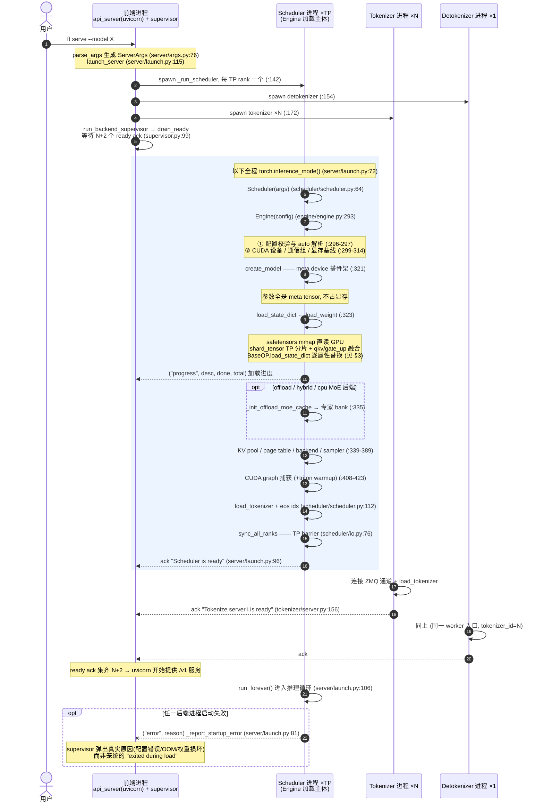

# 模型加载流程梳理（Model Loading Pipeline）

> 注（2026-10-28）：本文件写于 fork 分支（`--cpu-mem` 主机预算/全局专家池那套实现）。代码已同步上游 159 个提交，`--cpu-mem` 尚未重新并入；文中相关章节暂为历史参考。

本文梳理 FreeToken 从执行 `ft serve --model <path>` 到模型权重进入显存、CUDA graph 捕获完成、
可以对外提供推理服务的完整链路。所有引用均为 `python/freetoken/` 下的 `文件:行号`。

## 0. 总览

```
ft serve --model X                    (cli.py:104 main → cli.py:27 _run_serve)
  │
  ├─ parse_args → ServerArgs          (server/args.py:76)   dtype auto、tp_info、backend 解析
  │
  ├─ launch_server                    (server/launch.py:115)
  │    mp.set_start_method("spawn")   (server/launch.py:135)
  │    ├─ spawn TP×  scheduler 进程   ──→ _run_scheduler    (server/launch.py:58)
  │    ├─ spawn 1×  detokenizer 进程
  │    └─ spawn N×  tokenizer  进程
  │
  ├─ 前端进程: run_api_server          (server/api_server.py:918, uvicorn)
  │    run_backend_supervisor 阻塞等 ready ack   (server/supervisor.py:142 / :99)
  │
  └─ 【scheduler 进程内】
       Scheduler(args)                (scheduler/scheduler.py:61)
         ├─ Engine(config)            (engine/engine.py:293)   ← 模型加载主体，见 §2
         │    1. 配置校验/auto 解析
         │    2. CUDA 设备、通信组、显存基线
         │    3. meta device 上构建模型骨架（不占显存）
         │    4. load_weight 流式加载权重（TP 分片 + 张量融合）
         │    5. MoE offload 专家缓存（可选）
         │    6. KV cache / page table / backend / sampler
         │    7. CUDA graph 捕获
         ├─ load_tokenizer + eos ids  (scheduler/scheduler.py:112-113)
         └─ ack "Scheduler is ready"  (server/launch.py:96)
```

### 跨进程时序图

上图是调用结构，下面这张时序图补上**跨进程的时间顺序**：谁 spawn 谁、ack 在何时流动、
前端何时开始对外服务。



阅读要点：

- ack 队列(`mp.Queue`)是前端与后端之间唯一的启动期通道：进度、错误、ready 都走它，
  消息总数必须正好等于 `expected_acks = num_tokenizers + 2`(server/launch.py:192)，
  多发会阻塞、少发会超时。
- `Scheduler is ready` 发生在 tokenizer 加载和 ready 之后、`run_forever` 之前；
  tokenizer/detokenizer 进程是并行加载、各自 ack 的，所以前端看到进度条走完的时刻
  由最慢的那个进程决定。
- TP>1 时每个 rank 进程独立跑一遍上图蓝色区块(各自加载自己分片的权重)，
  rank 间通过 gloo/NCCL 组做显存基线与 barrier 同步；只有 primary rank 发 ack 和进度。

几个容易混淆的入口：

- `freetoken/launch.py` **不参与模型加载**，它是 `ft launch codex/claude/...`，作用是把
  codex、claude code 等编码 agent 的配置指向一个已在运行的 server。真正的服务端启动器是
  `server/launch.py`。
- `python -m freetoken` 直接调 `server.launch_server`，语义同 `ft serve`。
- `freetoken/core.py` 只定义运行期数据结构（`Req`/`Batch`/`Context`），与启动无关。

## 1. 进程模型

模型加载发生在 **scheduler 进程**内，与前端 API server 不同进程：

1. `launch_server`（server/launch.py:115）先 `parse_args` 得到 `ServerArgs`，再在
   `start_subprocess`（:130）里强制 `mp.set_start_method("spawn", force=True)`（:135）。
2. 每个 TP rank spawn 一个 `_run_scheduler` 进程（:142-151，进程名 `freetoken-TP{i}-scheduler`），
   另加 1 个 detokenizer 进程和 N 个 tokenizer 进程（:153-190）。
3. 前端进程留在 `run_api_server`（api_server.py:918）跑 uvicorn，并通过
   `run_backend_supervisor`（supervisor.py:142）在 `drain_ready`（:99）上等待
   `expected_acks = num_tokenizers + 2` 个 ready 消息；加载期间的
   `("progress", desc, done, total)` 消息被喂给进度条，子进程崩溃时读
   `("error", reason)` 把真实原因（配置错误、OOM、权重损坏）报给用户。
4. scheduler 进程在 `torch.inference_mode()` 下构造 `Scheduler(args)`（server/launch.py:72-74），
   ready 后向 ack 队列投 `"Scheduler is ready"`（:96），随后 `run_forever()` 进入推理循环。
5. 离线路径 `LLM`（llm/llm.py:30）直接继承 `Scheduler`，在**当前进程内**完成同样的加载（TP=1）。

## 2. Engine.__init__：加载主流程

`Engine.__init__`（engine/engine.py:293）按以下顺序执行（行号为调用点）：

### 2.1 配置与环境（:295-:297）

- `set_tp_info`：记录本进程的 TP rank/size。
- `_ensure_expandable_segments`（:948）：开启 CUDA allocator 的 expandable segments，
  必须发生在任何 CUDA 分配之前。
- `_adjust_config`（:1089）：校验并解析 dense/MoE/SWA/DSV4 相关配置，包括把
  `attention_backend="auto"` 解析成具体 backend（:116-154）。

### 2.2 设备、通信、显存基线（:299-:317）

- `torch.cuda.set_device` + 私有 stream（:299-303）。
- `resolve_pool_class`（:309 → kvcache/__init__.py:27）：按模型注意力结构（MHA/SWA/DSA/MLA/…）
  预选 KV pool 类，此后页数、成本估算都由该类的方法给出。
- `_init_communication`（:313，实现在 :425）：TP=1 或 `--use-pynccl` 时 gloo 进程组 +
  pynccl；否则 NCCL + gloo CPU 组。
- `_sync_get_memory`（:314，实现在 :655）：跨 rank all_reduce 出空闲显存的 MIN/MAX，
  作为后续 KV 预算的基线，并打日志 `Free memory before loading model`。

### 2.3 模型配置解析（懒加载，触发点在 model_config 首次访问）

- `EngineConfig.model_config`（engine/config.py:89，cached_property）→
  `cached_load_hf_config`（utils/hf.py:191）：
  - GGUF 目录 → `build_gguf_shim`（models/gguf/config.py:61）从 GGUF 元数据合成 config；
  - 普通 HF 目录 → `AutoConfig.from_pretrained(trust_remote_code=True)`，transformers 不认识的
    `model_type` 回退 `RawConfigShim`（hf.py:132）直接读原始 config.json。
- 再经注册表拿到该架构的 `parse_config`，把 HF config 转成统一的 `ModelConfig`
  dataclass（models/config.py:199-294）。这里完成：注意力分组体系
  （Full/SWA/LinearGDN/DSV4，:113-183）、`kv_cache_group_specs`（:387）、
  量化探测（compressed-tensors NVFP4、expert 量化格式，:21-74）、vision 默认关闭（:14-18）。

### 2.4 模型构建：meta device 上搭骨架（:321-:322）

```python
with torch.device("meta"), torch_dtype(config.dtype):
    self.model = create_model(config.model_config)
```

- `create_model`（models/__init__.py:27）→ `get_model_class`（models/register.py:140）：
  从注册表按 `architectures[0]` 字符串查 `ModelSpec`，惰性 import 模型模块并实例化。
- 模型类**不是 `nn.Module`**，是普通 Python 类 `BaseOP`（layers/base.py:15），子模块挂在
  `__dict__` 里。各层在 `__init__` 里用 `torch.empty` 预留参数形状——在 meta device 下
  这些只是零显存的形状描述符（meta tensor）。
- `torch_dtype(config.dtype)` 同时决定了之后 `load_state_dict` 的目标 dtype。

### 2.5 权重加载（:323，详见 §3）

```python
self.model.load_state_dict(self._load_weight_state_dict(config))
```

`_load_weight_state_dict`（engine/engine.py:452）：

- `--dummy-weight`：走 `_make_dummy_weight_state_dict`（:241），按 meta 参数的形状/dtype
  伪造随机权重（fp8 走 uint8 视图填充，MXFP8 的 scale_inv 填 127），用于不落盘的形状/性能验证。
- 正常路径：`_materialize_loaded_weight_state_dict`（:270）包裹 `load_weight(...)` 迭代器，
  逐 tensor 按 `model_state` 中的目标 dtype 做 cast（支持一个模型混多种 dtype，如 DSV4 的
  fp8/bf16/fp32），并搬运到本 rank 设备。
- offload MoE 模型传 `include_moe_experts=False`——专家不进 dense 权重，走 §2.6 的旁路。
- 加载完成后再次测显存，`_weights_bytes = baseline − 剩余`（:324-325），
  供 `--moe-cache-auto` 和桌面端缓存滑条使用。

### 2.6 MoE offload 专家缓存（:332-:337，仅 offload/hybrid/cpu 后端）

- `_init_offload_moe_cache`（:496）→ `load_expert_banks`（moe/expert_banks.py）：
  把每个专家层读成 pinned host 上的 "bank"（常驻内存，GPU 侧只留 `--moe-cache-size`
  大小的 slot 缓存，运行时按需换页）。FTW checkpoint 有快路径 `load_ftw_banks`
  （checkpoint/ftw.py:404）。
- 模型可自定义 `make_offload_moe_cache` 接管构建；随后调模型的
  `prepare_for_runtime()` 钩子（:336）做后处理。
- **内存预算 `--cpu-mem`（host 驻留）**：给了预算时 `_plan_host_residency`
  （engine/engine.py）按 `--cpu-mem-mode` 生成驻留计划，再穿进 `load_expert_banks`。
  两种模式（均启动时生效）：
  - **`expert`（默认，全局共享专家池）**：`plan_host_pool_slots`
    （engine/cache_budget.py，纯函数）把预算折算成 N 个 pinned 专家槽位，构成
    **跨所有 MoE 层共享的一个全局 host 池**（GPU slot cache 的主机侧镜像）。
    全部 bank 以文件后备加载（页缓存管常驻，CPU executor 直读、缺页透明）；
    池是每 bank 一个 `[N, rows]` 的注册 pinned 张量（`set_host_expert_pool`，
    启动时轮转预热：先每层各 pin 第 0 个专家、再第 1 个……）。decode 全层走
    hybrid：`_ensure_experts_hybrid_kernel` 读 `host_slot_for_id [L,E]` int32 表
    （-1 = 不在池），取回候选 = missing ∩ 在池，且 `src_indices` 直接写**池槽号**；
    `copy_missing(masked=True)` 用池基址 fused gather（地址固定，图捕获安全），
    不在池的 miss 写 -1 交 CPU executor。每步之间（`forward_batch` 尾部，默认
    每 16 步、`FREETOKEN_HOST_POOL_MAINTAIN_EVERY` 可调）`maintain_host_pool`
    按 `expert_recency`（kernel 每步都在维护）把最热但未入池的专家升入
    `host_usage` 最冷的槽——池里是**副本**，降级无需回写。prefill 不变：miss 走
    torch staging。
  - **`layer`（层级贪心，旧行为）**：`plan_host_residency` 按层号顺序整层
    pinned/可换出；spill 层是整段文件后备 bank，并入 `cpu_layer_ids`，decode 整层
    走 CPU executor（GPU 快路径只服务 pinned 层）。
- **显存预算 `--gpu-mem`（绝对值）**：`resolve_moe_cache_auto` / `_startup_kv_budget`
  的预算来源从 `memory_ratio × 空闲显存` 换成 `gpu_mem_budget − 已消耗`，槽位数与 KV
  页数在预算内 MoE 优先重解；graph/activation 在预算之上，初始化完校验超限告警。
  两级预算都会在 `("meta", …)` ack 里带出（`compute_cache_status_meta` →
  `/v1/cache/status` 的 `geometry.host`），`ft ctl cache` 渲染 Host 段。

### 2.7 KV cache 与运行时设施（:339-:423）

1. KV 预算：`_startup_kv_budget`（:65）= `memory_ratio × 加载前空闲显存 − 权重占用`，
   再扣除 GDN 线性注意力 state pool 的字节（:344）；`_pool_cls.solve_num_pages`（:345）
   把字节预算换算成页数。
2. `create_kv_pool`（:347 → kvcache/__init__.py:69）按 pool 族分配显存；
   有 GDN 组时再建 `LinearStatePool`（:352-365）。
3. page table（:371-379）：`(max_running_req+1) × aligned_max_seq_len` 的 int32 表，
   存 raw location 而非页号；`attach_page_table` 把它挂给 pool。
4. attention backend / MoE backend（:382-386）、`Sampler`（:389）。
5. CUDA graph：构造 `GraphRunner`（:408 → engine/graph.py:127 `_capture_graphs`），
   按显存决定 capture 的 bs 列表，逐 bs 捕获 decode graph。
6. triton backend 时跑一次 `_warmup_prefill`（:421 → :886）预热 autotune。

### 2.8 tokenizer 在 Engine 之外

`Scheduler.__init__`（scheduler/scheduler.py:61）在 `Engine(config)`（:64）返回后：
`load_tokenizer(config.model_path)`（:112 → utils/hf.py:25，HF AutoTokenizer /
GGUF tokenizer / Mistral chat_template.json）和 `load_eos_token_ids`（:113）。
独立的 tokenizer/detokenizer 进程各自加载自己的 tokenizer 副本。

## 3. 权重加载深入

### 3.1 两级分发

`load_weight`（models/weight.py:223）是权重读取的总入口，两级分发：

1. **FTW checkpoint**（目录里有 `freetoken_weight.json`，`is_ftw_checkpoint`
   checkpoint/ftw.py:102）：模型无关地 `iter_ftw_weights`（ftw.py:338）逐 tensor yield。
   FTW 是自定义的 fast-load 格式（`ft checkpoint` 转换生成）：单逻辑连续字节区按 8 GiB 切
   shard、每张量 4096 对齐，读取走多线程 O_DIRECT、探测失败回退 mmap。转换的本质就是
   "跑一遍真实加载器，把输出重排成对齐友好的布局"（checkpoint/convert.py:163）。
2. **普通 HF checkpoint**：`_spec_for_model_path`（weight.py:208）读 HF config →
   注册表 → 该模型的 `iter_weights`，`yield from` 转发（:249-256）。

### 3.2 模型注册表（models/register.py）

- `_MODEL_REGISTRY`（register.py:19）：键 = HF `config.json` 的 `architectures[0]`，
  值 = `ModelSpec(module, model_cls, parse_config="parse_config", iter_weights="iter_weights")`。
  惰性 import，不认识的架构报 `ValueError`（:128-132）。
- 覆写钩子：GGUF gemma4 把 `parse_config`/`iter_weights` 换成 GGUF 版本（:104-109）；
  多模态包装配置（MiniMax-M3、Muse-Glimmer、Gemma4 Unified 等）映射到纯文本 tower 的类。
- 当前注册的架构：Llama、Qwen2、Qwen3、Qwen3-MoE、Qwen3.5(-MoE)、MiniMax-M2/M3、
  DeepSeek-V4、Mistral(-3)、Gemma4（含 GGUF）、GptOss、GLM-4.5-MoE、GLM-MoE-DSA、Muse-Glimmer。

### 3.3 单模型迭代器（以 llama 为例，models/llama/weight.py:23）

所有模型的 `iter_weights` 都是**流式生成器**，逐 tensor 产出 `(name, tensor)`，三个步骤：

1. **读文件**：`iter_weight_files`（loader.py:50）glob `*.safetensors`（排除 consolidated）。
   `download_hf_weight`（utils/hf.py:207）在内部先做解析：本地目录直返，HF hub id 则
   `snapshot_download`（`--model-source modelscope` 走 modelscope），缓存到默认 HF 缓存目录。
2. **读 tensor + TP 分片**：`safetensors.safe_open(file, framework="pt", device=str(device))`
   （llama/weight.py:42）——safetensors 本身是 mmap-backed，device 直接传 cuda 意味着
   **从磁盘 mmap 直读进 GPU，没有 CPU 中转**。随后 `shard_tensor`（loader.py:24）按当前
   rank 切片：
   - `.q_proj/.k_proj/.v_proj/.gate_proj/.up_proj` → dim0 均分；GQA 的 k/v 在
     `num_kv_heads < world_size` 时按 head 精确取片（:34-37）；
   - `.o_proj/.down_proj` → dim1 均分；
   - `lm_head/embed_tokens` → vocab 区间分片（:41-46）。
3. **张量融合**：`iter_merged_tensors`（loader.py:110）按模型的 `MergeRule`
   （llama/weight.py:14-20）把 `q/k/v` 拼成 `qkv_proj`、`gate/up` 拼成 `gate_up_proj`，
   输出键名与模型 `state_dict()` 的键精确对应。

### 3.4 参数替换机制（layers/base.py:32）

`BaseOP.load_state_dict` 递归遍历 `__dict__`：对每个 tensor 属性，从迭代器给的字典里
`pop` 出同名 tensor，断言 shape/dtype 一致后**直接 `setattr` 整体替换**（:43-46）——
不是 `copy_` 进预分配 buffer。多余的键直接报错（:52-53），少键由各层 pop 时的 KeyError 暴露。
因此 loader 侧必须产出与 `state_dict()` 完全同名的、已分片/已融合的 tensor。

其余相关机制：

- **tied embedding**：`ParallelLMHead.load_state_dict`（layers/embedding.py）在 tied 时
  丢弃 lm_head 权重，forward 复用 embed 权重。
- **MoE**：常驻专家（`--moe-backend` 非 offload）由 `MoELayer` 分配 stacked `[E, ...]`
  大 tensor，`iter_stacked_experts`（loader.py:265）按专家堆叠写入；offload 模型的
  `OffloadMoELayer` 不分配专家参数，专家数据走 §2.6 的 bank 路径。
- **量化**：compressed-tensors NVFP4 密集层（qwen3_5、muse_glimmer 等）在 loader 侧读
  `weight_packed/weight_scale/weight_global_scale` 并做融合（loader.py:136 起）；
  fp8-block、GGUF Q4_0/Q6_K 由对应模型的 `iter_weights` 处理。
- **专家并行读取**：offload 加载时可走 `iter_expert_tensors_parallel`（weight.py:71）——
  多线程分块 O_DIRECT 读整个 shard + 后台 prefetch，`experts_scattered`（weight.py:169）
  用 safetensors 头里的专家平均大小决定走并行还是串行；读完后主动
  `posix_fadvise(DONTNEED)` 丢 page cache 防 host OOM（loader.py:56）。

### 3.5 dtype 语义

- `--dtype auto`（server/args.py）默认取 checkpoint 的 `torch_dtype`/`dtype`，兜底 bfloat16；
  该值决定 meta 模型的参数 dtype（§2.4）。
- 权重按 checkpoint 原生 dtype 从磁盘读出，在 `_materialize_loaded_weight_state_dict`
  （engine.py:270）里 cast 到目标 dtype。声明了 per-tensor dtype 的模型（DSV4 混合 fp8/bf16）
  因此得以保留。

## 4. 时间序完整调用链（TP=1）

1. `ft serve --model X` → `cli.py:104 main` → `:27 _run_serve` → `server/launch.py:115 launch_server`
2. `server/args.py:76 parse_args` → `ServerArgs`（dtype auto 解析、tp_info、backend 解析）
3. `server/launch.py:135` spawn：scheduler 进程 + tokenizer/detokenizer 进程
4. 前端进程 `api_server.py:918 run_api_server` → `supervisor.py:142 run_backend_supervisor`
   阻塞在 `drain_ready`（:99）
5. 【scheduler 进程】`server/launch.py:74` → `scheduler/scheduler.py:64 Engine(config)`
6. `engine/engine.py:293`：`:296` expandable segments → `:297 _adjust_config` →
   `:300` CUDA 设备/stream → `:309 resolve_pool_class` → `:313 _init_communication` →
   `:314 _sync_get_memory` 显存基线
7. `:322 create_model`（meta device）→ `register.py:140 get_model_class` →
   `models/<arch>/model.py` 实例化（参数全为 meta tensor）
8. `:323 load_state_dict` → `:452 _load_weight_state_dict` → `models/weight.py:223 load_weight`
   →（FTW? `checkpoint/ftw.py:338` ：否则 `models/llama/weight.py:23 iter_weights`：
   `loader.py:50 iter_weight_files`（内含 hub 解析 `utils/hf.py:207`）→
   `safetensors.safe_open(device=cuda)` mmap 直读 → `loader.py:24 shard_tensor` TP 分片 →
   `loader.py:110 iter_merged_tensors` 融合）→ `layers/base.py:32 BaseOP.load_state_dict`
   逐属性 setattr
9. `:324` 权重后显存测量；offload MoE 时 `:335 _init_offload_moe_cache` →
   `moe/expert_banks.py load_expert_banks`（FTW 快路径 `ftw.py:404 load_ftw_banks`）；
   `:336 prepare_for_runtime` 模型钩子
10. KV cache：`:343 _startup_kv_budget` → `:345 solve_num_pages` → `:347 create_kv_pool` →
    `:356 LinearStatePool`（如需）→ `:371 page_table` + `:379 attach_page_table`
11. `:382 create_attention_backend`、`:386 create_moe_backend`、`:389 Sampler`
12. `:408 GraphRunner` → `engine/graph.py:127 _capture_graphs` CUDA graph 捕获；
    triton backend 时 `:423 _warmup_prefill`
13. 回到 `scheduler/scheduler.py:112 load_tokenizer` + `:113 load_eos_token_ids`，
    以及 CacheManager/TableManager 等运行期管理器（:70-92）
14. `server/launch.py:96` ack `"Scheduler is ready"` → 前端 ready gate 翻转 →
    `scheduler.run_forever()` 开始服务请求
